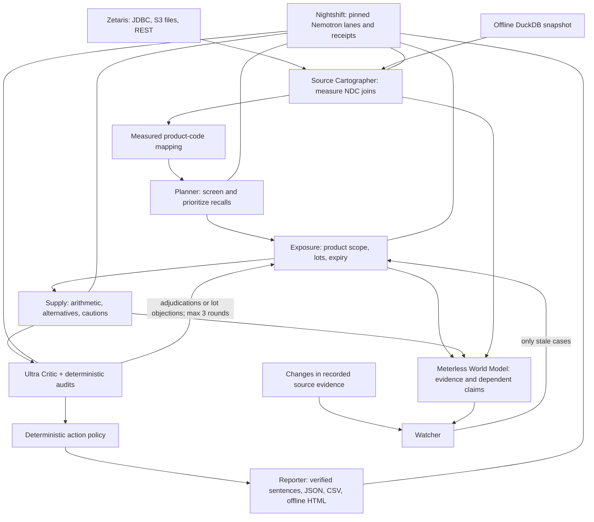

# Lotline

Lotline helps a hospital pharmacy buyer respond to a drug recall: identify affected lots and locations, calculate the supply left after quarantine, screen alternatives, and produce a checklist with evidence. A watcher reopens dependent conclusions when recorded source evidence changes. It proposes actions; it does not move stock, place orders, or authorize clinical substitutions.

The demo hospital, Riverside General, and wholesaler, MedLine Distribution, are **fictional**. The FDA product and recall records are real snapshot data.

## Try it without credentials

Use Node.js 20 or later and npm. In a clone or downloaded copy of this repository:

```sh
npm install
npm run demo
```

No `.env`, Docker, Zetaris or Nightshift account is needed. DuckDB reads the included files, the real agents execute, and recorded model replies replay only when the entire request hash matches. Unrecorded or invalid replies use labelled deterministic fallbacks. The demo starts an ephemeral `riverside-sample` world each time and prints the HTML packet and index paths under `runs/`. Open either file directly in a browser; there are no external assets or scripts.

The Naropin case has two affected lot rows and one expiry discrepancy requiring a label check: 68 unexpired units quarantined, 143 → 75 usable units, and 16.6 → 8.7 days of supply. A pharmacist must resolve the discrepancy and review substitutions. “Approved” means the automated critic's result, never clinical authorization.

## Why these sources need reconciliation

Project research over 1,000 recalls reported in 2025–26 found **19 generic drugs both recalled and on the shortage list**. This research finding is recorded in the project design (`../final-ranking.md`, section 4), not a count independently reproduced from the smaller bundled snapshot. The bundled six-molecule subset contains 615 recalls, 227 shortage rows and 2,350 NDC packages.

In the actual hospital fixture, a naive join of 11-digit hospital NDCs to hyphenated FDA package NDCs matches **0 of 10 items**; segment normalization matches **10 of 10**. The shortage subset matches 7 of 10 after normalization. Wholesaler identifiers lose leading zeros: padding raises the overlap from 5 to 8 items. Absence from a source is not proof of availability.

The Naropin recall's `openfda_package_ndc` contains **41 family NDCs**, but its description names only **two** (`63323-286-23`, `63323-286-05`). Treating the family list as the recall's scope would include other sizes and strengths. Lot matching therefore follows a separate product-coverage decision. The clindamycin notice also says “900 mg per 50 mL (12 mg/mL)”; the arithmetic is 18 mg/mL, and the packet flags the inconsistency.

## Live setup

Install Zetaris Docker separately, and configure a Nightshift runtime with the NVIDIA provider. Fill a local `.env` from the placeholders in `.env.example`; do not commit it. Start Lotline's synthetic PostgreSQL and S3-compatible sources:

```sh
cp .env.example .env
# Fill in credentials locally before continuing.
docker compose --env-file .env -f infra/docker-compose.yml up -d
npm install
npm run data:fetch && npm run data:seed && npm run data:upload && npm run setup:zetaris
npm run lotline -- run D-0727-2026
```

The registration SQL assumes bucket `lotline`. Zetaris reaches PostgreSQL at `host.docker.internal:55433` and SeaweedFS at port 9000. Configure Zetaris's per-bucket S3A endpoint for HTTP at `host.docker.internal:9000`, SSL disabled, and its own local credentials. Our Zetaris installation uses virtual-host S3 URLs: its container must resolve `lotline.host.docker.internal` to the host gateway, while SeaweedFS uses `-s3.domainName=host.docker.internal`. Keep source ports reachable only by your development environment.

`npm run setup:zetaris` registers sources, publishes the crosswalk view and creates five non-admin users and roles: cartographer, planner, exposure, supply and watcher. Each role receives SELECT on its required tables only. Generated local test passwords are written only to `.env`; the administrator key is used only by setup. Runtime users obtain an in-memory ID token with Basic-auth login. A per-user API key can be supplied instead. See [the principal policy](src/data/policy.ts) and [DCL](scripts/setup_zetaris_principals.sql). Existing registrations and grants are retained on setup reruns; setup does not reconcile a differently configured existing object.

Fetching fresh openFDA data changes cassette request hashes and evaluation assumptions. Keep the bundled snapshot for a reproducible demo. Live calls are bounded by a default 600-second CLI timeout; `--timeout-seconds` accepts 1–2400. Lightning generally responds faster than Ultra, but failed calls may retry once and unavailable models fall back visibly.

## Commands and watcher drill

```sh
npm run lotline -- run D-0727-2026 --ephemeral
npm run lotline -- run D-0727-2026 --no-critic
npm run lotline -- sweep --max 6
npm run lotline -- watch
npx tsx scripts/render-run.ts <run-id>
npx tsx scripts/promote-cassette.ts <live-run-id> [bundle-name]
```

Prefix commands with `SAMPLE_MODE=true` for offline operation. `--today YYYY-MM-DD` sets the inventory comparison date (default **2026-10-24**). A sweep triages relevant ongoing recalls; a watch needs persistent case runs. `LOTLINE_WORLD_DIR` can isolate a drill's world from normal work.

For an offline drill, run the baseline without `--ephemeral`, change a source, watch, and reset it:

```sh
SAMPLE_MODE=true npm run lotline -- run D-0727-2026
SAMPLE_MODE=true npx tsx scripts/drill.ts expand D-0727-2026
SAMPLE_MODE=true npm run lotline -- watch
SAMPLE_MODE=true npx tsx scripts/drill.ts reset
```

The expansion adds lot 6133437. `drill.ts wholesaler` marks Baxter 43066-0019-10 Backorder; `drill.ts shortage` marks Naropin 63323-286-23 Unavailable in the shortage snapshot. Each is simulated fixture data, not an FDA or wholesaler announcement. Run `watch` after a change. `reset` restores all three bundled baselines. Live mode writes the same object-storage keys Zetaris reads; the external FDA API itself is never modified.

The watcher refreshes recall text plus revisions, item master and package hierarchy, inventory, dispensing aggregates, open purchase orders, snapshot/live shortages, catalog availability, directory candidates and crosswalk probes. Shared projections keep evidence hashes consistent. Empty query results track absence and membership; deleted source rows have durable missing markers. Each case lists changed table/key/fields and stale claims before re-derivation. Only dependent claims become stale; the agents recompute each affected case. The rolling usage window is anchored to the case's recorded hospital date.

## Architecture



Every conclusion references evidence or upstream claim IDs. The packet presents buyer actions first, then coverage, audits, revisions, SQL, model receipts and the full trace. Native disclosures and checkboxes work offline; checklist state is not saved. The index links every packet in a sweep.

## Sponsor technology

**Zetaris.** Six logical source domains—hospital, recalls, shortages, NDC directory, wholesaler, change feed—span JDBC, S3 JSON/CSV and REST. This is not six physical connectors: registration creates hospital, snapshot, wholesaler, live FDA, and updates families, plus view containers. The agent catalog exposes 12 logical tables. The Cartographer tests join candidates; setup publishes `lotline_views.ndc_crosswalk`, a queryable SchemaStore view (not a separately persisted result cache). The change feed supports the labelled expansion drill.

**Meterless World Model.** The Apache-2.0 reference at commit `1742dec56a66e58eef9dda2d2b865823758ca8cd` supplies events, entities, facts, views and conflict resolution. Lotline provides append-only JSONL persistence, replay-faithful fact resolution and evidence/claim truth maintenance; see [NOTICE](engines/world-model/NOTICE). The upstream conformance runner is unmodified. Validation runs all eight checks plus dependency, staleness and persistence tests.

**Nightshift and NVIDIA.** All model HTTP requests go through Nightshift's `/chat/completions` provider contract, with bearer authentication and app/scope headers. The fast lane is pinned to `nvidia/nemotron-3.5-lightning-30b-a3b` for crosswalk hypotheses, planning, recall/coverage extraction, alternative selection and verified summary selection. The deep lane is `nvidia/nemotron-3-ultra-550b-a55b` for senior review and adjudication. Structured fast requests disable thinking using `chat_template_kwargs.enable_thinking=false`; Ultra review retains reasoning. Generic routing aliases are deliberately avoided. Each trace records requested/routed model, provider, receipt ID, reported latency, token counts, cost and replay/cache status, including failed attempts where receipt fields can be absent.

See [the standalone sponsor explanation](docs/sponsor-tech.md) and [the measured ablation](eval/results/ablation-2026-10-25.md).

### Where the engine is used (judges look here)

| Feature | Engine use | Code |
|---|---|---|
| Reusable product-code mapping | Crosswalk evidence and claims | `src/agents/cartographer.ts`, `src/context.ts` |
| Product scope and lot verdicts | Claims depend on recall text, stock rows and coverage | `src/agents/exposure.ts` |
| Supply and alternatives | Claims link usage, lot and alternative conclusions | `src/agents/supply.ts` |
| Revision loop | Agents reassert stable claims after adjudication | `src/orchestrator.ts` |
| Changed or missing source evidence | Evidence hashes invalidate dependent claims transitively | `src/watch.ts`, `engines/world-model/src/claims.ts` |
| Restart and audit | Append-only events reconstruct the world | `engines/world-model/src/store.ts` |
| Buyer evidence links | Packet lot and action claim IDs | `src/agents/reporter.ts`, `src/render.ts` |

## Evaluation

```sh
npm run typecheck
npm test
npm run engine:conformance
SAMPLE_MODE=true npx tsx eval/run-exposure.ts
npx tsx scripts/check-parity.ts  # requires live Zetaris, no model calls
```

The exposure key contains 21 labelled anchor rows; the offline evaluation scores 21/21. Recordings cover six live anchors and one watch drill. Replay executes real DuckDB queries and matches complete model-request hashes. Run the commands above to reproduce every figure; the live critic ablation results are in [eval/results/](eval/results/).

The live critic ablation completed in 14.33 minutes: **230/230 lot verdicts in each arm**, zero wrongly quarantined or missed recalled units, one coverage dispute (dextrose 70%) resolved by Ultra, two adjudications and eight objections. **No lot-verdict accuracy improvement was demonstrated.** Ultra added 658,441 ms of model time; the baseline used 183,405 ms.

The critic experiment uses ten real recalls: six anchors and four compounded/different-product traps. Both arms use identical frozen inputs; Lightning replies are generated live and shared within each pair to control sampling noise. Only the treatment adds live Ultra review and revision. This is a small, selected diagnostic set, not an estimate of clinical safety. The original key denominator and all 230 inventory-case pairs are reported separately. Do not rerun the live experiment for the demo; its dated JSON and Markdown include raw failures, disagreements, adjudications, objections, escalations, latency and receipts.

## Data, licences and pre-existing work

[Data provenance and regeneration](data/README.md) describes the openFDA CC0/public-domain snapshot, fictional hospital and wholesaler fixtures, and clearly labelled simulated change feed. No patient records are included. openFDA is unvalidated and is not a medical-care authority.

The Meterless reference is the declared pre-existing implementation, retained under Apache-2.0 with its LICENSE, NOTICE and upstream commit. Package dependencies and infrastructure images are third-party components identified in the lockfile and compose file. The repository does not independently certify the hackathon's build-window eligibility. No additional pre-existing application component is claimed.

## Limitations and security

- Snapshot scope covers six molecules and a fictional ten-item hospital. The default date is fixed; shortages, listing status and wholesaler availability can change.
- Product matching is bounded heuristics plus model review. Complex expiry ranges, all-lot notices, compound products and unit/container conversions need pharmacist scrutiny. Matching ingredient and strength is not clinical interchangeability.
- The watcher is a polling command over recorded dependencies, not a continuous subscription. It does not discover new recall cases; use `sweep`. Reads across independent sources are not an atomic snapshot. Source failures prevent a successful freshness check.
- Different container/volume, repackager provenance and source disagreement remain explicit cautions. There is no purchasing or quarantine writeback, authentication layer for shared packets, or clinical authorization service.
- Per-agent SELECT grants are enforced by Zetaris and a shared allowlist in DuckDB. Principal names and refusals appear in the trace and packet. This is application access control, not process isolation from a developer who can read `.env`. The local SQL gate accepts only the application's generated read syntax.
- Models can disagree, time out or produce invalid JSON. Revisions stop after three rounds; pending changes require pharmacist escalation. Deterministic fallbacks are labelled. Model “approval” cannot override clinical review.
- `.env`, runs, worlds, dependencies and browser state are ignored. Public cassettes contain LLM request/response bodies only, never authorization headers or SQL recordings; promotion rejects suspected secrets. Receipts identify compute, not credentials. Final public-file scans and checks are recorded in the report; keep local credentials out of new artifacts.
